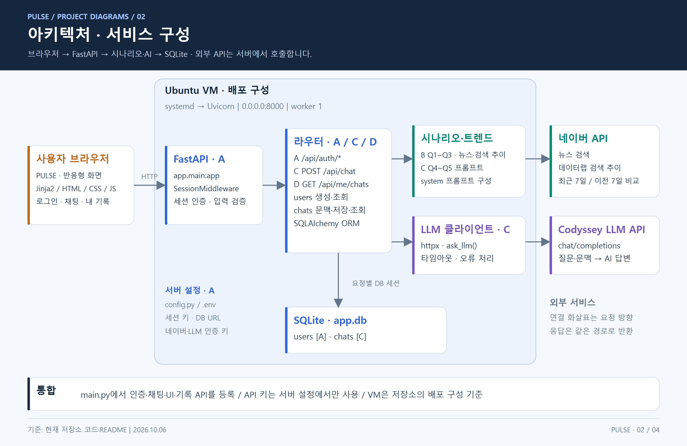
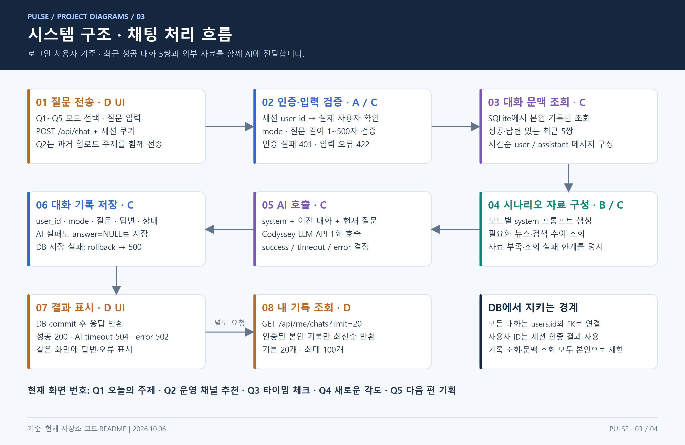
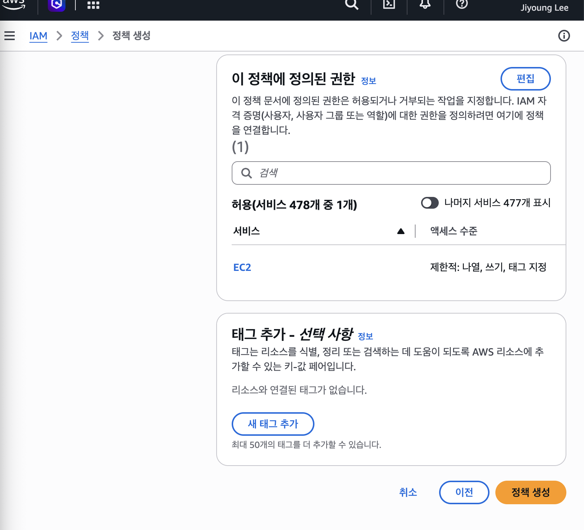

<!-- @format -->

# Cloud Launch — PULSE 챗봇을 AWS에 올리기

로컬에서 실행하던 PULSE 챗봇을 내 컴퓨터가 꺼져 있어도 접속할 수 있도록 EC2에 올리는 프로젝트입니다. 앱은 FastAPI와 SQLite를 사용하며, Nginx가 외부 요청을 받아 앱으로 전달하는 구성으로 준비했습니다.

이 저장소에는 배포 과정과 확인 결과를 남깁니다. 실제 배포 대상 코드는 별도 저장소인 [ai_chatbot](https://github.com/L-jy16/ai_chatbot)입니다. 아래 명령은 Ubuntu 24.04 LTS, 서버 사용자 `ubuntu`, 설치 경로 `/home/ubuntu/ai_chatbot`을 기준으로 합니다.

> 확인 자료: 로컬 기본 응답과 IAM 사용자 준비 화면. 아래 서버 구성·접속·정리 명령은 실습 절차이며, 응답 예시는 실제 배포 결과와 구분합니다.

처음에는 앱 실행과 인터넷 공개를 같은 단계로 생각하기 쉽지만, 앱이 켜져 있어도 외부에서 들어오는 경로가 없으면 접속할 수 없습니다. 그래서 네트워크 연결, 서버 내부 실행, 외부 접속을 나눠 확인하는 순서로 정리했습니다.

## 배포 대상과 현재 확인 결과

배포 대상은 직접 만든 PULSE 챗봇입니다. 로그인한 사용자의 질문을 받아 네이버 자료와 AI 응답을 연결하고, 사용자별 대화를 SQLite에 저장합니다. 단순한 정적 페이지와 달리 앱 프로세스, DB 파일, 외부 API 통신을 함께 고려해야 합니다.

| 확인 대상 | 확보한 자료 | 확인 범위 |
| --- | --- | --- |
| 앱 구조 | 아래 서비스 구성도·요청 흐름도 | 설계 설명, 서버 가동 증거는 아님 |
| 로컬 기본 응답 | 앞선 로컬 임시 설정 검사 | `/health`, `/login`, `/signup` 200; AWS 접속 결과는 아님 |
| IAM 준비 | [실제 설정 화면](#iam-설정-과정에서-남긴-화면) | 사용자 `Lee` 생성과 정책 연결 검토 |
| 로그인 문제 분석 | [트러블슈팅 기록](docs/troubleshooting.md) | 프로젝트 방식과 루트·IAM 로그인 차이 확인 |
| 리소스 정리 절차 | [정리 체크리스트](docs/cleanup-checklist.md) | 실습 종료 시 사용할 점검 항목 |

### 기존 앱의 서비스 구성



출처: `ai_chatbot/docs/images/diagrams/02-architecture.png`(2026-10-06). 기존 앱의 배포 설계도이며 실제 EC2 실행 화면은 아닙니다. 그림의 `0.0.0.0:8000`은 기존 직접 공개 방식입니다. 이번 실습은 **Nginx 80 → Uvicorn 127.0.0.1:8000**으로 바꾸고, 외부에서는 80번 포트만 사용하도록 계획했습니다. 아래 AWS 네트워크 구성과 함께 읽어야 합니다.

### 서버가 처리하는 요청



출처: `ai_chatbot/docs/images/diagrams/03-system-flow.png`(2026-10-06). 로그인 후 채팅 요청은 사용자 확인, 자료 수집, AI 호출, DB 저장을 거칩니다. 그래서 외부 접속 확인은 이 전체 처리와 분리된 `GET /health`를 선택했습니다. `/health`의 고정 응답은 앱까지 요청이 전달되었음을 확인하지만, 실제 AI 인증이나 대화 저장까지 증명하지는 않습니다.

## 1. 배포 구조

```text
외부 브라우저 / curl → EC2 퍼블릭 IPv4의 80번 포트
                         │
┌ VPC 10.0.0.0/16 ────────┼─────────────────────────────┐
│ Internet Gateway ←─────┘                             │
│ Public Subnet 10.0.1.0/24                             │
│   연결된 Route Table: local + 0.0.0.0/0 → IGW        │
│   EC2 [Security Group: 80 공개 / 22 내 IP만 허용]     │
│     Nginx :80 → Uvicorn 127.0.0.1:8000 → FastAPI     │
│                                           ├ SQLite  │
│                                           └ 외부 API│
└──────────────────────────────────────────────────────┘
```

요청은 IGW를 통해 VPC 안의 EC2로 들어오고, 보안 그룹을 통과한 뒤 Nginx와 FastAPI로 전달됩니다. Route Table은 패킷을 전달할 경로를 정하고, 보안 그룹은 인스턴스에 허용할 통신을 정합니다. Route Table이 요청을 처리하는 서버인 것은 아닙니다.

`0.0.0.0/0 → IGW`는 VPC 내부 주소가 아닌 목적지로 보낼 때 사용하는 기본 경로입니다. 이 경로가 없으면 서버가 외부 API에 요청하거나 인터넷으로 응답을 돌려보낼 길이 없습니다. 다만 이 경로만으로 인터넷 접속이 완성되지는 않습니다. 서브넷 연결, 퍼블릭 IPv4, SG 규칙도 함께 맞아야 합니다.

이 그림은 구성 계획입니다. 실제 리소스가 만들어지면 이름과 연결을 대조해 `docs/architecture.png` 또는 PDF로 저장합니다.

- 공개 포트: HTTP 80, 내 공인 IP에서만 SSH 22
- 앱 포트 8000: EC2 내부 루프백에서만 수신
- 외부 접속 검증: **B 방식**, `GET http://<퍼블릭IP>/health`
- 정상 응답: HTTP 200, `{"status":"ok"}`
- 이번 기본 구성은 Docker 없이 HTTP로 먼저 연결합니다. HTTP 단계에서는 실습용 계정과 데이터만 사용하고, 실제 사용자 운영 전에는 HTTPS를 적용하세요.

## 2. 서버를 만들기 전 정한 기준

1. AWS 작업은 실습용 IAM 사용자/Role의 제한된 권한으로 수행합니다. 현재 프로젝트 방식에서는 IAM 사용자의 콘솔 로그인이 지원되지 않아 `Lee`의 CLI 사용을 준비했습니다. 프로젝트 소유자의 콘솔 권한과 `Lee`의 정책은 별개이며, 실제 작업 주체 확인은 남아 있습니다. 루트 계정을 실습에 사용하지 않습니다.
2. 리전을 **서울(ap-northeast-2)**로 고정합니다.
3. 계정의 무료 사용 조건, 크레딧 잔액과 만료일을 확인합니다. micro 인스턴스라고 반드시 무료인 것은 아닙니다.
4. IAM 권한은 EC2·VPC·Subnet·Route Table·IGW·Security Group·키페어·볼륨의 실습에 필요한 조회/생성/연결/태그/수정/삭제 작업으로 제한합니다. `AdministratorAccess`나 무관한 S3/RDS 권한을 부여하지 않습니다. 실제 정책의 Action·Resource·Condition과 적용 근거를 기록하세요. 기존 관리자에게 계정과 실습 권한을 준비받을 수 있습니다.
5. 리소스에 `Project=cloud-launch` 태그를 붙이고 ID를 기록합니다. IAM은 AWS 작업 권한, SG는 인스턴스 네트워크 접근을 제어합니다.

### IAM 설정 과정에서 남긴 화면

2026년 10월 26일(KST)에 AWS 프로젝트 환경에서 사용자 지정 정책 `CloudLaunchLabPolicy`를 만들고, 실습용 IAM 사용자 `Lee`에 연결했습니다. 다음은 실제 설정 과정의 화면입니다.

**허용 서비스 확인**

정책 검토 화면에서 허용 서비스가 EC2 하나이고, 접근 수준이 제한된 나열·쓰기·태그 지정으로 표시되는 것을 확인했습니다. VPC·Subnet·라우팅·IGW·SG 구성 작업도 EC2 권한에 포함되므로 별도 VPC 서비스 항목은 표시되지 않습니다. 이 화면만으로 개별 Action과 서울 리전 조건까지 확인되는 것은 아니므로 실제 정책 JSON은 별도로 대조해야 합니다.



**실습 사용자에 정책 연결**

사용자 생성 검토 화면에서 이름을 `Lee`로 지정하고 `CloudLaunchLabPolicy`만 연결한 것을 확인했습니다. 화면의 콘솔 암호 유형은 `None`이며, 웹 로그인용 비밀번호는 설정되지 않았습니다.


**사용자 생성 후 확인**

생성 후 `Lee`의 상세 화면과 보안 자격 증명 탭을 확인했습니다. 이때 액세스 키 목록은 0개였습니다. 이후 CLI 사용을 위한 키 생성은 진행했지만, 키 값이 담긴 화면은 보관 자료에 포함하지 않았습니다. 실제 작업 전 CLI에서 호출 주체와 허용 권한을 확인합니다.


현재 사용하는 새 AWS 프로젝트 방식에서는 IAM 사용자의 콘솔 로그인이 지원되지 않습니다. 따라서 프로젝트 소유자로 콘솔에서 수행한 작업을 `Lee`의 제한된 권한으로 수행한 작업이라고 기록하지 않습니다. 실습 작업의 주체는 CLI 인증 결과 등으로 별도 확인해야 합니다. [AWS IAM 사용자 안내](https://docs.aws.amazon.com/IAM/latest/UserGuide/id_users.html)

| 확인 항목 | 현재 근거와 상태 |
| --- | --- |
| 사용자 지정 정책 생성 | 정책 검토 화면 및 사용자 생성 검토 화면에서 확인 |
| IAM 사용자 생성 | `Lee` 상세 화면에서 확인 |
| 정책 연결 | 사용자 생성 검토 화면에 `CloudLaunchLabPolicy` 표시 |
| CLI 키 생성 | 본인 생성 완료 확인, 키 값은 문서에 미포함 |

## 3. 네트워크 생성 — AWS 콘솔

VPC 콘솔에서 아래 순서로 직접 생성합니다. 이 구성에는 NAT Gateway, ALB, RDS가 필요하지 않습니다.

| 순서 | 리소스           | 예시 설정                                                               |
| ---- | ---------------- | ----------------------------------------------------------------------- |
| 1    | VPC              | 이름 `cloud-launch-vpc`, IPv4 CIDR `10.0.0.0/16`, DNS resolution 활성화 |
| 2    | Subnet           | 위 VPC, 서울 AZ 1개, 이름 `cloud-launch-public`, CIDR `10.0.1.0/24`     |
| 3    | Internet Gateway | `cloud-launch-igw` 생성 후 위 VPC에 연결                                |
| 4    | Route Table      | 위 VPC에 `cloud-launch-public-rt` 생성                                  |
| 5    | 경로             | 기존 local 경로 유지, `0.0.0.0/0`의 대상에 위 IGW 추가                  |
| 6    | 서브넷 연결      | Route Table의 명시적 서브넷 연결에 위 Public Subnet 지정                |

기본 NACL은 그대로 사용합니다. 직접 제한했다면 응답 트래픽까지 고려해야 합니다.

## 4. 외부에 열 포트와 EC2 설정

EC2 콘솔에서 다음 설정으로 인스턴스를 시작합니다.

- 이름: `cloud-launch-web`
- AMI: Ubuntu Server 24.04 LTS, x86_64
- 유형: 계정에서 무료 혜택 적용을 확인한 micro 인스턴스 1대
- 스토리지: EBS 8~10GiB, 루트 볼륨의 종료 시 삭제 여부 확인
- 키페어: 생성 후 `.pem` 파일 안전하게 보관, Git에 추가하지 않기
- 네트워크: 직접 만든 VPC와 Public Subnet
- 퍼블릭 IPv4 자동 할당: 활성화
- Security Group: 해당 VPC에 `cloud-launch-web-sg` 생성

인바운드 규칙:

| 유형 | 포트   | 소스                                   |
| ---- | ------ | -------------------------------------- |
| HTTP | TCP 80 | `0.0.0.0/0`                            |
| SSH  | TCP 22 | 콘솔의 내 IP 선택: `<내 공인 IPv4>/32` |

80은 사용자가 웹 서비스에 접속하는 입구라 공개하고, 22는 서버 관리용이라 내 IP로만 제한합니다. SSH를 전체 인터넷에 열면 불특정 주소의 로그인 시도까지 받게 됩니다. 접속 장소가 바뀌면 전체 공개하는 대신 내 IP 규칙을 갱신합니다.

8000은 Nginx에서 앱으로 전달하는 내부 포트라 공개할 이유가 없습니다. SQLite는 파일 기반이라 별도 DB 수신 포트도 없습니다. 나중에 별도 DB를 쓰더라도 전체 인터넷에 공개하지 않고 앱 서버의 SG 등 필요한 출처로 제한합니다.

SG는 서버로 들어오는 네트워크 통신을 제어하고, IAM은 누가 EC2를 생성하거나 삭제하는 등의 AWS API 작업을 할 수 있는지 제어합니다. SSH가 막힌 문제를 IAM 관리자 권한으로 해결할 수는 없습니다. 반대로 EC2 생성 권한 부족을 SG 변경으로 해결할 수도 없습니다.

8000 포트와 전체 포트 개방 규칙은 추가하지 않습니다. 기본 아웃바운드 허용을 유지해 패키지 설치와 외부 API 통신을 가능하게 합니다. 인스턴스 상태 검사를 통과하면 퍼블릭 IPv4를 기록합니다.

## 5. SSH 접속 — 내 컴퓨터

`<...>` 부분은 실제 값으로 바꾸고 실행합니다.

```bash
chmod 400 "/키파일/경로/cloud-launch.pem"
ssh -i "/키파일/경로/cloud-launch.pem" ubuntu@<퍼블릭IP>
```

접속이 안 되면 퍼블릭 IP, SSH 사용자 `ubuntu`, 키페어, SG의 내 공인 IP, 서브넷의 Route Table 연결을 확인합니다. 내 네트워크가 바뀌면 SG의 SSH 소스도 갱신합니다.

## 6. 앱 설치 — EC2 터미널

```bash
sudo apt update
sudo apt install -y git python3 python3-venv nginx curl
cd /home/ubuntu
git clone https://github.com/L-jy16/ai_chatbot.git
cd /home/ubuntu/ai_chatbot
python3 -m venv .venv
.venv/bin/python -m pip install -r requirements.txt
.venv/bin/python -m pip check
```

저장소가 비공개라면 본인에게 허용된 Git 인증 방식을 사용하세요. 인증 토큰을 URL이나 README에 적지 않습니다. 이미 clone한 폴더가 있다면 다시 clone하지 말고 기존 폴더에서 작업합니다.

환경 변수는 서버에서 별도로 준비합니다. 로컬 `.env`나 개인 DB를 Git에 올리지 않습니다.

```bash
cd /home/ubuntu/ai_chatbot
# .env가 없을 때만 예제를 복사
cp -n .env.example .env
chmod 600 .env
.venv/bin/python -c 'import secrets; print(secrets.token_hex(32))'
nano .env
```

생성한 난수를 `SECRET_KEY`에 넣습니다. 실제 AI 응답을 쓰려면 `LLM_API_KEY`, 뉴스·검색 추이를 쓰려면 `NAVER_CLIENT_ID`와 `NAVER_CLIENT_SECRET`도 입력합니다. 나머지 기본값은 `.env.example`을 참고합니다. 키가 없는 상태의 health 성공은 AI 연결 성공을 뜻하지 않습니다.

## 7. FastAPI 상시 실행 — systemd

기존 `deploy/ai-chatbot.service`는 8000 포트를 모든 인터페이스에 바인딩합니다. 이번 구성에서는 아래처럼 **127.0.0.1**로 제한한 서비스 파일을 사용합니다.

```bash
sudo tee /etc/systemd/system/ai-chatbot.service > /dev/null <<'SERVICE'
[Unit]
Description=PULSE FastAPI chatbot
After=network-online.target
Wants=network-online.target

[Service]
Type=simple
User=ubuntu
WorkingDirectory=/home/ubuntu/ai_chatbot
ExecStart=/home/ubuntu/ai_chatbot/.venv/bin/uvicorn app.main:app --host 127.0.0.1 --port 8000 --workers 1
Restart=on-failure
RestartSec=3

[Install]
WantedBy=multi-user.target
SERVICE
sudo systemctl daemon-reload
sudo systemctl enable --now ai-chatbot
sudo systemctl status ai-chatbot --no-pager
curl -i http://127.0.0.1:8000/health
```

`200 OK`와 `{"status":"ok"}`를 확인합니다. 앱은 작업 폴더의 `.env`를 읽고, 기본 설정에서 같은 폴더에 SQLite DB를 만듭니다. SQLite 사용을 고려해 worker는 1개로 둡니다.

## 8. Nginx로 HTTP 80 연결

```bash
sudo tee /etc/nginx/sites-available/cloud-launch > /dev/null <<'NGINX'
server {
    listen 80 default_server;
    server_name _;

    location / {
        proxy_pass http://127.0.0.1:8000;
        proxy_set_header Host $host;
        proxy_set_header X-Real-IP $remote_addr;
        proxy_set_header X-Forwarded-For $proxy_add_x_forwarded_for;
        proxy_set_header X-Forwarded-Proto $scheme;
        proxy_read_timeout 120s;
    }
}
NGINX
sudo ln -sfn /etc/nginx/sites-available/cloud-launch /etc/nginx/sites-enabled/cloud-launch
# 이 실습용 신규 서버의 기본 사이트만 비활성화
sudo unlink /etc/nginx/sites-enabled/default
sudo nginx -t
sudo systemctl enable --now nginx
sudo systemctl reload nginx
curl -i http://localhost/health
curl -i http://localhost
curl -I https://example.com
```

`default` 링크가 이미 없다면 unlink 단계는 생략합니다. `nginx -t`가 성공한 경우에만 reload합니다. `/health`는 200이 나와야 합니다. 비로그인 상태의 `/`는 로그인 화면으로 리다이렉트될 수 있습니다. `curl -i http://localhost/`가 303이라면 루트 경로의 직접 200 응답을 확인한 것이 아닙니다. `curl -i http://localhost/login`은 별도 GET 요청으로 화면 응답을 확인하는 용도입니다. 루트 경로 자체의 200 응답까지 요구되는 경우에는 공개 소개 화면 등 앱의 `/` 동작을 조정한 뒤 다시 확인해야 합니다. 이 문서에서는 해당 변경이 완료되었다고 기록하지 않습니다.

UFW를 이미 활성화했다면 먼저 현재 SSH 접속을 유지할 수 있도록 허용 규칙을 추가하고 HTTP를 허용합니다.

```bash
sudo ufw status
# active일 때만, 실제 내 IP로 바꿔 실행
sudo ufw allow from <내공인IP> to any port 22 proto tcp
sudo ufw allow 80/tcp
```

## 9. 접속 확인은 /health부터

외부 접속 확인은 **B 방식인 GET /health**로 진행합니다. 로그인 화면이나 AI API 상태의 영향을 줄이고, HTTP 코드와 고정 JSON을 함께 확인할 수 있기 때문입니다. 이 앱에는 `/health`가 이미 구현되어 있어 별도 테스트 페이지도 필요하지 않습니다. Nginx의 80번 포트가 이 요청을 FastAPI로 전달하도록 구성합니다.

EC2 안에서 성공한 요청은 외부 연결의 증거가 되지 않으므로, **내 컴퓨터 터미널**에서 실행합니다.

```bash
curl -i http://<퍼블릭IP>/health
```

예상 결과:

```text
HTTP/1.1 200 OK
...
{"status":"ok"}
```

명령의 URL과 응답이 함께 보이는 화면을 캡처합니다. 브라우저에서 `http://<퍼블릭IP>/login`도 확인하고 실습용 계정으로 회원가입·로그인·채팅을 점검합니다. `https://` 자동 전환 시 이 단계에서는 주소를 `http://`로 입력하세요.

접속 자료에는 B 방식, 실제 URL, 확인 시각(KST), HTTP 코드와 고정 응답을 함께 남깁니다. 캡처 파일은 `docs/external-access.png`로 저장합니다.

## 10. 접속이 안 될 때 확인할 순서

외부 접속 실패는 먼저 **라우팅 → SG → 퍼블릭 IP/DNS → 서버 프로세스와 로그** 순서로 범위를 좁힙니다. VPC의 IGW 연결과 서브넷의 실제 Route Table을 확인하고, SG에서 요청 포트와 출처를 확인합니다. 그다음 현재 퍼블릭 IP와 요청 주소를 대조합니다. 도메인을 사용한다면 DNS가 현재 주소를 가리키는지도 확인합니다. 서버를 재시작한 뒤 주소가 달라졌는지 확인하는 것도 이 단계입니다.

경로가 맞으면 SSH로 접속해 `ss`로 수신 포트를 보고, `localhost/health`와 `127.0.0.1:8000/health`를 비교합니다. 전자는 실패하고 후자는 성공하면 Nginx 쪽을, 둘 다 실패하면 앱 프로세스 쪽을 먼저 살펴봅니다. HTTP 502를 받았다면 외부 요청이 Nginx까지는 도착한 것이므로 앱 연결과 로그부터 확인할 수 있습니다.

```bash
sudo journalctl -u ai-chatbot -n 100 --no-pager
sudo systemctl status nginx --no-pager
sudo nginx -t
sudo tail -n 50 /var/log/nginx/error.log
sudo ss -lntp
```

| 관찰한 증상 | 다음에 확인할 근거 |
| --- | --- |
| SSH 시간 초과 | IGW·Route Table 연결, SG 22의 내 IP, 현재 퍼블릭 IP |
| HTTP 시간 초과 | 라우팅, SG 80, 요청 주소, UFW와 Nginx 수신 상태 |
| 502 Bad Gateway | 앱의 8000 수신 상태와 systemd 로그 |
| Nginx 기본 페이지 표시 | 활성화된 사이트 설정과 `nginx -t` 결과 |
| health 성공, AI 실패 | 앱 로그와 외부 API 설정·인증·타임아웃 |

설정을 여러 개 동시에 바꾸면 무엇이 원인이었는지 알기 어렵습니다. 먼저 원인 가설을 적고, 그 가설을 확인할 명령과 로그를 고른 뒤 한 항목씩 바꿉니다. 변경 전후에 같은 요청을 보내 상태 코드와 로그 시각을 비교합니다. 실제로 겪은 프로젝트 로그인 문제와 확인 과정을 [트러블슈팅 기록](docs/troubleshooting.md)에 남겼습니다. 배포 중 문제가 발생하면 서버 로그와 변경 전후 결과도 같은 형식으로 추가합니다.

`docs/troubleshooting.md`에 실제 1건 이상을 다음 형식으로 기록합니다. 예시를 실제 해결 이력처럼 제출하지 마세요.

```text
증상:
원인 가설:
검증 명령/로그와 관찰 결과:
조치:
조치 후 결과:
재발 방지:
```

## 11. 업데이트

변경 전 필요한 DB와 설정은 접근 제한된 위치에 백업합니다. `.env`와 `app.db`는 업데이트 중 덮어쓰지 않습니다.

```bash
cd /home/ubuntu/ai_chatbot
git pull --ff-only
.venv/bin/python -m pip install -r requirements.txt
sudo systemctl restart ai-chatbot
curl -i http://localhost/health
```

## 12. 배포 과정에서 남길 자료

설정 설명과 실제 실행 결과를 함께 볼 수 있도록 `cloud-launch/docs/`에 자료를 모읍니다. 현재 IAM 설정 화면과 기존 앱 구조도는 `docs/images/`에 저장했습니다. 트러블슈팅과 정리 체크리스트도 작성했으며, 실제 네트워크 그림·외부 접속·삭제 결과는 추가 확인이 필요합니다.

```text
cloud-launch/
├── README.md
└── docs/
    ├── images/                  # IAM 설정 3장 + 기존 앱 구조도 2장
    ├── architecture.png          # 또는 architecture.pdf
    ├── external-access.png       # 외부 curl의 URL·200·본문 증빙
    ├── troubleshooting.md        # 실제 로그인 문제와 해결 과정
    └── cleanup-checklist.md      # 실습 종료 시 사용할 정리 체크리스트
```

네트워크·SG·IAM 설정과 내부 curl 결과도 캡처하면 구성과 최소권한 설명의 근거로 사용할 수 있습니다. 키·토큰·쿠키가 포함된 화면은 제출하지 않습니다.

## 13. 만든 리소스를 추적하고 정리하기

리소스 이름은 `cloud-launch-` 접두어로 맞추고 `Project=cloud-launch` 태그를 붙입니다. 이름은 콘솔에서 찾는 용도이고, 실제 정리 대상을 구분할 때는 리소스 ID와 리전도 함께 대조합니다. 자동 생성된 볼륨이나 네트워크 인터페이스까지 태그가 전파되었다고 가정하지 않고 별도로 확인합니다.

Elastic IP를 만들지 않았다면 실제 목록을 확인한 뒤 ‘미생성’으로 남깁니다. 체크 표시만으로 완료 처리하지 않고, 삭제 후 상태나 조회 목록을 근거로 남깁니다.

증빙 확보 후 **이 실습에서 만든 리소스만** 정리하고 `docs/cleanup-checklist.md`에 리소스 ID, 완료 시각, 확인 근거를 남깁니다. 서비스를 정리하면 기록한 URL은 더 이상 접속되지 않으므로 README에 종료 시각도 기록하세요.

- [ ] EC2: Stop이 아닌 **Terminate**, 최종 상태 확인
- [ ] EBS: 종료 시 삭제 여부 확인, 남은 실습 볼륨 삭제
- [ ] Elastic IP: 할당한 경우 Release, 없으면 미생성 기록
- [ ] 실습 스냅샷: 생성했다면 필요 여부 확인 후 정리
- [ ] NAT Gateway/ALB/RDS: 생성했다면 삭제, 없으면 미생성 기록
- [ ] 네트워크 인터페이스 등 VPC 삭제를 막는 의존성 확인
- [ ] Internet Gateway: VPC에서 Detach 후 삭제
- [ ] 실습 Subnet·사용자 지정 Route Table·SG 정리 후 VPC 삭제
- [ ] 실습 전용 키페어와 불필요한 IAM 자격증명 정리
- [ ] Billing/사용량 확인 — 반영 지연이 있을 수 있어 잔존 리소스 목록도 함께 확인

공유 IAM·기존 VPC 등 다른 실습이나 사용자가 쓰는 리소스는 정리 대상에서 제외합니다.

## 14. 권한·트래픽·비용 문제가 생긴다면

이 절은 현재 구성에서 예상되는 운영 상황을 검토한 내용입니다. 실제로 발생하거나 확장 작업을 마친 기록은 아닙니다.

### 권한 부족으로 생성 작업이 실패할 때

`AccessDenied`나 `UnauthorizedOperation`이 나오면 오류의 호출 주체, Action, 대상 Resource, 리전, 시각부터 기록합니다. 필요하면 관리자에게 해당 시각의 CloudTrail 이벤트 확인을 요청합니다. 민감한 오류 원문이나 계정 정보는 공개 문서에 그대로 붙이지 않습니다.

예를 들어 태그 생성 작업이 거부되었다면 전체 관리자 권한을 붙이는 대신, 실제로 필요한 `ec2:CreateTags`와 적용 대상·조건을 검토합니다. EC2 생성은 AMI·Subnet·SG·볼륨 등 여러 리소스 권한이 관련되므로 인스턴스 ARN 하나만 확인하고 끝내지 않습니다. 리소스 범위를 지원하지 않는 조회 Action은 필요한 항목에 한해 별도 Statement로 분리합니다. 적용한 정책과 허용 이유를 기록한 뒤 같은 작업을 재시도합니다.

명시적 Deny, permissions boundary, 조직 SCP에 막힌 경우에는 Allow를 더 붙여도 해결되지 않을 수 있습니다. 해당 제한의 관리 주체에게 확인하고, 이 앱에서 필요하지 않은 S3·RDS 권한까지 추가하지 않습니다. [AWS의 접근 거부 오류 안내](https://docs.aws.amazon.com/IAM/latest/UserGuide/troubleshoot_access-denied.html)를 기준으로 원인을 구분합니다.

정책 변경 기록에는 사용자/Role과 정책 이름, 수정한 Action·Resource·Condition, 권한이 필요한 이유, 같은 작업의 재시도 결과를 남깁니다.

### 접속자가 늘어 EC2를 두 대로 늘린다면

먼저 CPU·메모리, 요청 지연, SQLite 쓰기 경합, 외부 AI·네이버 API 응답 시간을 확인합니다. AI 제공자의 지연이나 호출 제한이 원인이면 EC2만 늘려도 해결되지 않습니다.

서버 처리량이나 가용성이 문제라면 앞단에 ALB를 두고 두 EC2를 Target Group에 등록하는 구성을 검토합니다. ALB는 서로 다른 가용 영역의 서브넷 두 개 이상을 사용하도록 설계하고, `/health`로 대상의 기본 상태를 확인합니다. 앱 서버의 HTTP 포트는 ALB의 SG에서 오는 요청만 받도록 바꿉니다. 이때 `/health` 성공만으로 DB와 외부 AI까지 정상이라고 판단하지는 않습니다.

현재 앱은 EC2의 로컬 SQLite 파일에 사용자와 대화를 저장하므로 서버 두 대가 서로 다른 DB를 보게 됩니다. 따라서 실제 확장 전에 공유 DB로의 이전과 기존 데이터 마이그레이션을 준비해야 합니다. 서명된 세션 쿠키를 두 서버에서 검증할 수 있도록 `SECRET_KEY`도 동일하게 관리합니다. 이 앱의 세션이 서버 메모리에 저장된다고 가정해 sticky session만 켜는 것으로 DB 불일치를 해결할 수는 없습니다. [ALB 구성 문서](https://docs.aws.amazon.com/elasticloadbalancing/latest/application/application-load-balancers.html)를 참고하되, 이 확장안은 현재 실습에 적용하지 않았습니다.

### 예상하지 못한 비용이 보인다면

Billing/Cost Explorer에서 발생 기간, 서비스, 리전, 사용 유형을 좁힌 뒤 실제 리소스 목록과 대조합니다. EC2 실행 시간뿐 아니라 EBS·스냅샷, 퍼블릭 IPv4·Elastic IP, NAT Gateway, ALB, RDS, 데이터 전송을 확인합니다. 태그가 비용 화면에서 바로 검색된다고 가정하지 않고 리소스 ID 목록도 함께 사용합니다.

사용하지 않는 실습 리소스를 찾으면 의존성을 확인하고 정리합니다. EC2를 Stop한 것만으로 EBS 등 연관 비용이 없어졌다고 판단하지 않으며, 할당된 Elastic IP와 남은 볼륨도 확인합니다. 비용 반영에는 지연이 있을 수 있으므로 삭제 직후 청구액이 사라지는 대신, 더 이상 사용 중인 리소스가 없는지와 이후 사용량을 함께 확인합니다. 다른 프로젝트에서 쓰는 리소스는 비용이 보인다는 이유만으로 삭제하지 않습니다.

## 공식 참고 자료

- [AWS: Internet Gateway와 퍼블릭 서브넷의 인터넷 연결](https://docs.aws.amazon.com/vpc/latest/userguide/working-with-igw.html)
- [AWS: Free Tier 계정별 체계 변경 안내](https://aws.amazon.com/blogs/aws/aws-free-tier-update-new-customers-can-get-started-and-explore-aws-with-up-to-200-in-credits/)
- [Nginx: proxy_pass 및 proxy_read_timeout](https://nginx.org/en/docs/http/ngx_http_proxy_module.html)
