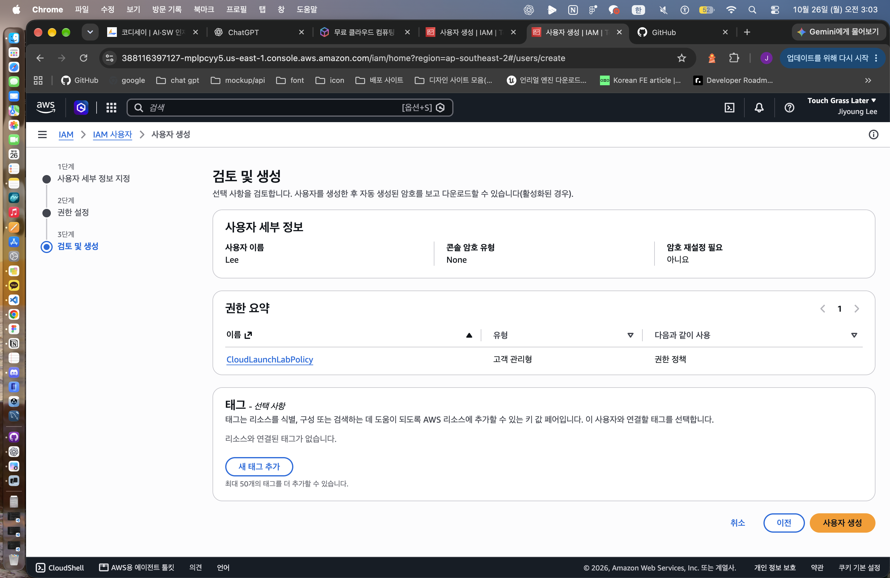
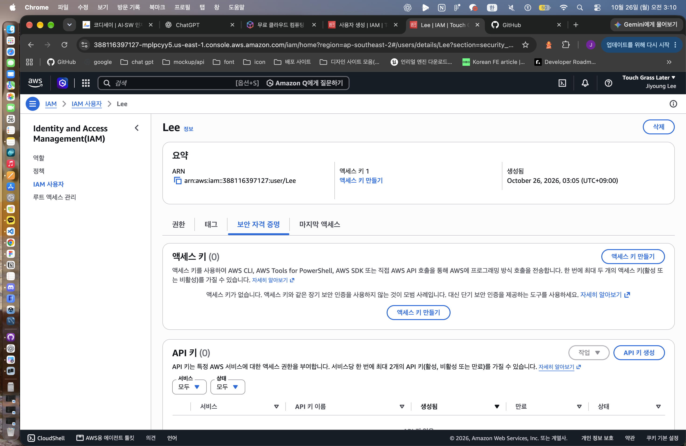

# 프로젝트 로그인 과정에서 겪은 문제

기록일: 2026-10-26 (KST). 이 기록은 실제 대화와 제공된 화면을 근거로 작성했습니다. EC2 접속 장애 해결 기록은 아닙니다.

## 증상

새로 가입한 뒤 IAM 사용자를 준비하려고 루트 이메일 로그인을 시도했습니다. 로그인 화면에 ‘잘못된 요청’과 쿠키 삭제 안내가 표시되었습니다. 시크릿 창에서도 같은 오류가 이어졌습니다.

## 원인 가설

처음에는 기존 로그인 쿠키나 세션 문제를 의심했습니다. 이후 AWS 설정의 프로젝트 목록과 소셜 로그인 선택 화면이 확인되어, 기존 루트 계정 방식과 새 프로젝트 가입 방식이 다를 수 있다고 판단했습니다.

## 검증과 근거

- 쿠키 영향을 줄이기 위한 시크릿 창 재시도 후에도 같은 오류가 발생했다는 사용자 확인이 있었습니다. 따라서 쿠키만을 원인으로 단정하지 않았습니다.
- 이후 AWS 설정의 프로젝트 화면, 가입 연락처 입력 화면, 프로젝트 관리 콘솔 진입 화면을 확인했습니다.
- 생성한 `Lee`의 검토 화면에는 콘솔 암호 유형이 `None`으로 표시되었고, 생성 후 보안 자격 증명 탭에도 콘솔 비밀번호 설정이 보이지 않았습니다.
- [AWS 계정 루트 사용자 문서](https://docs.aws.amazon.com/accounts/latest/reference/root-user.html)는 프로젝트 계정이 Builder ID 소유이며 루트 이메일로 접근하는 구조가 아니라고 설명합니다.
- [AWS IAM 사용자 문서](https://docs.aws.amazon.com/IAM/latest/UserGuide/id_users.html)는 새 프로젝트 방식에서 IAM 사용자 콘솔 로그인을 지원하지 않는다고 설명합니다.

로그인 오류 자체의 내부 원인을 서버 로그로 확정한 것은 아닙니다. 확인된 가입 유형에 맞는 접근 경로를 찾은 사례입니다.

## 조치

루트 로그인을 반복하는 대신 새 AWS 로그인 경로로 프로젝트 환경에 접근했습니다. 프로젝트 관리 콘솔에서 IAM 사용자 `Lee`와 `CloudLaunchLabPolicy`를 준비했습니다. IAM 콘솔 로그인을 지원하지 않는 점을 확인한 뒤, 제한된 사용자로 작업하기 위한 CLI 경로로 전환하고 액세스 키를 생성했습니다. 키 값은 문서에 넣지 않았습니다.

## 결과

IAM 사용자 상세 화면까지 접근한 것은 확인했습니다. 사용자는 키 생성 완료를 확인했습니다. 다음 단계는 Mac의 CLI에서 `Lee` 호출 주체와 리소스 생성 권한을 확인하는 것입니다. 웹 콘솔 접속 문제를 해결한 결과와 실제 배포 성공을 구분합니다.

## 재발 방지

가입 유형과 로그인 방식을 먼저 확인한 뒤 안내를 적용합니다. 화면에 설정이 없으면 기존 절차를 반복하기 전에 공식 지원 범위를 확인합니다. 실제 작업 전 `aws sts get-caller-identity --profile cloud-launch`로 호출 주체가 `user/Lee`인지 확인하고, 프로젝트 소유자 콘솔의 권한을 제한 사용자 권한으로 오인하지 않습니다.

## 배포 중 문제가 발생하면 추가할 내용

발생 시각, 증상, 원인 가설, 검증 명령·로그의 관찰 결과, 변경한 설정, 같은 요청의 변경 후 결과, 재발 방지를 순서대로 남깁니다. 아직 겪지 않은 SSH·Nginx 오류를 해결한 사례로 작성하지 않습니다.
